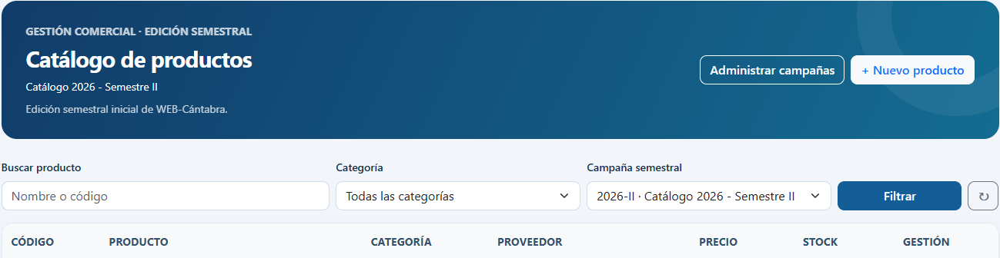

# WEB-Cántabra

Prototipo académico de gestión de órdenes de compra que desarrollé en SENATI. Permite seguir un pedido desde el catálogo de una campaña semestral hasta su entrega, con vistas para clientes, vendedores y personal de almacén.



## Recorrido del pedido

1. El cliente consulta productos, arma su carrito y registra el pedido.
2. El vendedor revisa el pago y consulta los pedidos de la campaña.
3. El personal de almacén prepara el envío y registra la entrega. Los movimientos quedan reflejados en el inventario.

## Tecnologías

Python y Flask para la aplicación, SQLite para los datos y plantillas Jinja con HTML, CSS y Bootstrap para la interfaz. Los reportes se pueden exportar a CSV y Excel mediante openpyxl.

## Ejecutar en Windows

Con Python 3.11 o superior instalado, abre una terminal en la raíz del repositorio y ejecuta:

```powershell
python iniciar.py
```

El lanzador prepara el entorno e instala las dependencias. Abre http://127.0.0.1:5000 en tu navegador. Las cuentas de ejemplo, las pruebas y la configuración se describen en la [guía de demostración local](docs/guia-local.md).
